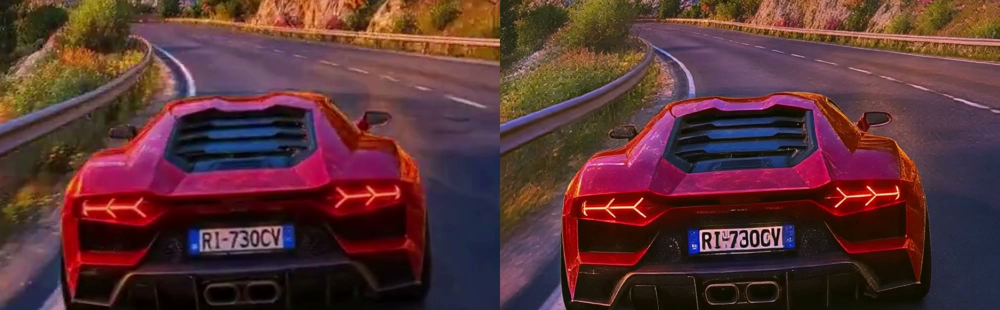
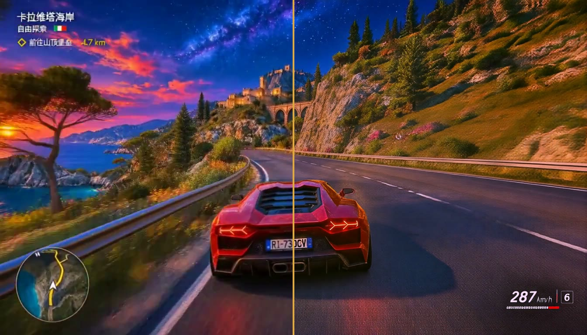
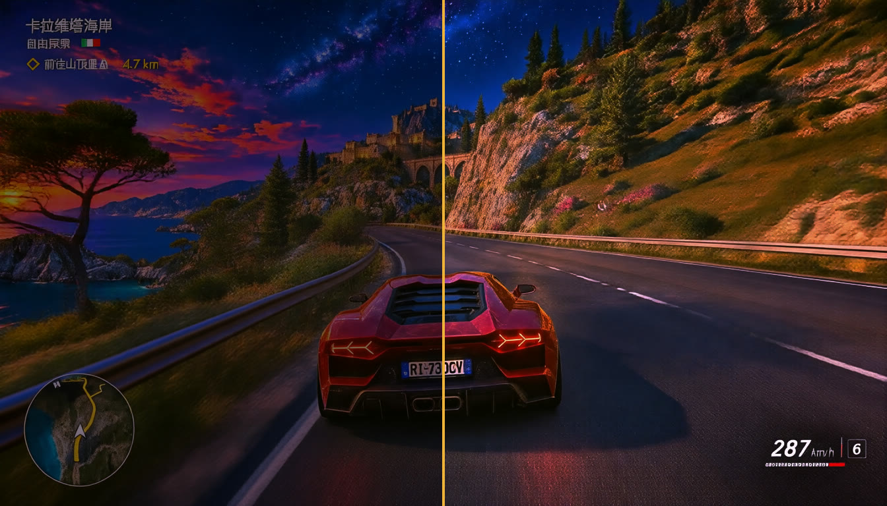

<div align="center">

# FlashVSR HDR Lab

**模糊视频 → 2 倍超分 → 超亮 HDR，一个 ComfyUI 工作流跑完。**

FlashVSR 视频超分 × HLG HDR 输出的 ComfyUI 工作流、HDR 保存节点和本地对比网页。

[](https://github.com/lonely-dance-lab/flashvsr-hdr-comfyui/releases/latest)
[](https://github.com/Comfy-Org/ComfyUI)
[](https://github.com/OpenImagingLab/FlashVSR)
[](#hdr-是怎么变亮的)
[](LICENSE)

[快速开始](#快速开始) · [参数说明](#参数说明) · [HDR 原理](#hdr-是怎么变亮的) · [对比演示](#对比演示) · [常见问题](#常见问题)



<sub>左：原片 1344×768 直接放大 · 右：FlashVSR 2× 超分 2688×1536（同一帧，局部裁切）</sub>

</div>

---

一段 1344×768 的模糊视频，在 RTX 4090 48G 上 **约 150 秒** 超分到 2688×1536，同时输出一份 **HLG HDR** 版本。在 MacBook Pro XDR 屏或 iPhone 上播放，高光会用到屏幕峰值亮度，比普通视频亮一截。

## 特性

- **一个工作流两份输出**：SDR 超分版 `flashvsr_x2_*.mp4` + HDR 超亮版 `flashvsr_hdr_*.mp4`，原声保留
- **默认参数已调好**：`tiny-long` 模式，长视频显存基本不随时长增加，10 秒视频峰值约 40G
- **HDR 保存节点**：提亮曲线 + 10-bit HEVC + HLG / BT.2020 标记，苹果设备、Safari、Chrome 直接播放
- **不用 ComfyUI 也能做 HDR**：附一条 FFmpeg 脚本，任何 SDR 视频一行命令转成 HLG
- **本地对比网页**：分屏拖动、三路并排、逐帧、慢放、4× 放大，双击 `demo/index.html` 即可打开

## 快速开始

### 1. 安装 FlashVSR 插件和模型

本工作流依赖 [ComfyUI-FlashVSR_Ultra_Fast](https://github.com/lihaoyun6/ComfyUI-FlashVSR_Ultra_Fast)（无需编译 Block-Sparse-Attention）：

```bash
cd ComfyUI/custom_nodes
git clone https://github.com/lihaoyun6/ComfyUI-FlashVSR_Ultra_Fast.git
pip install -r ComfyUI-FlashVSR_Ultra_Fast/requirements.txt
```

模型放到 `ComfyUI/models/FlashVSR/`（v1）或 `ComfyUI/models/FlashVSR-v1.1/`，四个文件：

```text
ComfyUI/models/FlashVSR/
├── diffusion_pytorch_model_streaming_dmd.safetensors   # 5.7G
├── LQ_proj_in.ckpt                                     # 0.58G
├── TCDecoder.ckpt                                      # 0.19G
└── Wan2.1_VAE.pth                                      # 0.5G
```

下载地址：[HuggingFace · FlashVSR](https://huggingface.co/JunhaoZhuang/FlashVSR) · [HuggingFace · FlashVSR-v1.1](https://huggingface.co/JunhaoZhuang/FlashVSR-v1.1) · [ModelScope](https://modelscope.cn/models/AI-ModelScope/FlashVSR)。目录不存在时，插件会在第一次运行时自动从 HuggingFace 下载。

### 2. 安装 HDR 保存节点

```bash
git clone https://github.com/lonely-dance-lab/flashvsr-hdr-comfyui.git
cp -r flashvsr-hdr-comfyui/custom_nodes/ComfyUI-HLG-HDR-Save ComfyUI/custom_nodes/
```

节点只依赖 ComfyUI 自带的 PyAV（需含 `libx265`，官方 wheel 默认带）。重启 ComfyUI 后，在 `FlashVSR` 分类下能看到 **保存 HDR 视频 (HLG · HEVC 10-bit)**。

### 3. 导入工作流运行

1. 把 [`workflows/flashvsr-hdr.json`](workflows/flashvsr-hdr.json) 拖进 ComfyUI。
2. 在 **Load Video** 里上传视频。
3. 点击 **Run / 运行**。

输出在 `ComfyUI/output/video/`。不需要 HDR 时，右键 HDR 节点选 **Bypass**。

<details>
<summary>用 API / 命令行跑</summary>

视频先放进 `ComfyUI/input/`，然后：

```bash
python scripts/run_api.py input.mp4                       # 默认 2×、tiny-long、特别亮
python scripts/run_api.py input.mp4 --brightness 标准亮
python scripts/run_api.py input.mp4 --no-hdr              # 只要 SDR 超分
python scripts/run_api.py input.mp4 --server http://127.0.0.1:8188
```

API 格式的工作流见 [`workflows/api/flashvsr-hdr.api.json`](workflows/api/flashvsr-hdr.api.json)。

</details>

## 工作流

```text
Load Video → Get Video Components → FlashVSR Ultra-Fast ─┬→ Create Video → Save Video          SDR  flashvsr_x2_*.mp4
                                                         └→ 保存 HDR 视频 (HLG · HEVC 10-bit)   HDR  flashvsr_hdr_*.mp4
```

## 参数说明

### FlashVSR Ultra-Fast

| 参数 | 本工作流 | 说明 |
| --- | --- | --- |
| model | `FlashVSR` | v1。官方称 v1.1 更稳，有 v1.1 权重可直接切换 |
| mode | **`tiny-long`** | 边推理边解码，显存基本不随视频长度增加。**推荐** |
| scale | `2` | 可选 4。1344×768 的 4 倍是 5376×3072，很慢且容易爆显存 |
| tiled_vae | 开 | |
| tiled_dit | 关 | 48G 显存可以关；显存不够就打开，更省但更慢 |
| unload_dit | 开 | 降低解码阶段显存峰值 |

**tiny 和 tiny-long 的区别**：画质相同，区别在解码时机。`tiny` 等全部帧推理完再一次性解码整段，显存随视频长度上涨；`tiny-long` 每算完一小段就解码并移到内存。实测 10 秒 243 帧 2× 超分，`tiny` 在解码阶段爆显存（48G），`tiny-long` 峰值约 40G 跑通。`full` 模式用完整 Wan2.1 VAE 解码，画质最高也最吃显存。

### 保存 HDR 视频 (HLG · HEVC 10-bit)

| 参数 | 默认 | 说明 |
| --- | --- | --- |
| brightness | `特别亮` | 提亮曲线：特别亮 / 标准亮 / 不提亮 |
| crf | `16` | 越小画质越好、文件越大 |
| preset | `fast` | x265 预设，`medium` / `slow` 更慢、压缩率更高 |
| fps / audio | 接 Get Video Components | 帧率自动吸附到标准值（24.0047 → 24） |

### 实测性能

| 输入 | 输出 | 硬件 | 超分耗时 | 显存峰值 | HDR 编码 |
| --- | --- | --- | --- | --- | --- |
| 1344×768 · 243 帧 · 24 fps | 2688×1536 | RTX 4090 48G | ~150 s | ~40G | ~60 s |

## HDR 是怎么变亮的

普通视频的白色在屏幕上大约一两百尼特。支持 HDR 的屏幕识别到 **HLG** 标记后会进入 HDR 模式，信号最高处用到 1000 尼特以上的峰值亮度。

这个节点做三件事：

1. 用单调曲线把中高光往上推，最亮处顶到 10-bit 信号上限
2. RGB 按 BT.2020 矩阵转成 10-bit YUV（limited range）
3. 写入 HLG（`arib-std-b67`）/ BT.2020 标记，HEVC 编码，`hvc1` 标签保证苹果设备能播

不用 ComfyUI，一行命令也能做：

```bash
scripts/hdr_hlg.sh input.mp4                  # 特别亮，输出 input_HDR.mp4
scripts/hdr_hlg.sh input.mp4 out.mp4 standard # 标准亮
```

两种方式输出一致（同一输入逐帧 PSNR 约 42.7 dB）。

> [!NOTE]
> 只有 HDR 屏幕（MacBook Pro XDR、iPhone、部分安卓和显示器）+ Safari / Chrome / QuickTime 才能看到变亮。普通屏幕和截图上看和 SDR 差不多。部分平台上传后会转回 SDR。

## 对比演示

```bash
open demo/index.html   # macOS；或直接双击
```

| 文件 | 内容 | 规格 |
| --- | --- | --- |
| `demo/1.mp4` | 原片 | 1344×768 · H.264 · SDR |
| `demo/2.mp4` | FlashVSR 2× 超分 | 2688×1536 · H.264 · SDR |
| `demo/3.mp4` | 超分 + HDR 特别亮 | 2688×1536 · HEVC Main 10 · HLG |

网页支持 **1 ↔ 2 / 2 ↔ 3 分屏拖动**、**1 · 2 · 3 并排**、同步播放、逐帧（`,` `.`）、0.25× 慢放、2× / 4× 放大平移。仓库内 2、3 号压到约 13 Mbps，原画质版本在 [Releases](https://github.com/lonely-dance-lab/flashvsr-hdr-comfyui/releases/latest) 下载。Firefox 不支持 HEVC，请用 Safari 或 Chrome。

**1 ↔ 2 超分**



<sub>左半：原片 1344×768 · 右半：FlashVSR 2× 超分 2688×1536</sub>

**2 ↔ 3 HDR 高亮**



<sub>左半：SDR 超分 · 右半：HLG HDR 特别亮。<b>示意图</b>：按 HDR 屏幕上 SDR 白 203 尼特（ITU-R BT.2408）、HLG 峰值 1000 尼特换算成普通图片，真实效果请在 HDR 屏幕上播放 <code>demo/3.mp4</code>。</sub>

| 同一帧，HDR 屏幕上 | SDR 超分 | HDR 特别亮 |
| --- | --- | --- |
| 平均亮度 | ~16 nits | **~58 nits**（约 3.6×） |
| 高光（99 分位） | ~141 nits | **~717 nits** |

## 常见问题

<details>
<summary><b>爆显存（out of memory）</b></summary>

依次尝试：`mode` 改 `tiny-long` → 打开 `tiled_dit` → 打开 `unload_dit` → `scale` 用 2 → 先把视频切短。

</details>

<details>
<summary><b>超分后颜色偏淡</b></summary>

把节点换成 **FlashVSR Ultra-Fast (Advanced)**，打开 `color_fix`。

</details>

<details>
<summary><b>车牌、文字变形</b></summary>

FlashVSR 是生成式超分，会"补"出细节。实测车牌 `RI-730CV` 超分后末位接近 `CY`，边缘有轻微扭曲。需要准确文字的场景请逐帧检查。

</details>

<details>
<summary><b>HDR 视频看起来没变亮</b></summary>

确认三点：屏幕支持 HDR、播放器支持 HLG（Safari / Chrome / QuickTime）、系统亮度没开省电模式。用手机拍屏幕录像才能拍出亮度差，截图看不出来。

</details>

<details>
<summary><b>model 选 v1.1 后开始下载</b></summary>

插件按 `model` 名找 `ComfyUI/models/<model>/` 目录，找不到就从 HuggingFace 下载。只放了 v1 权重时请选 `FlashVSR`。

</details>

## 项目结构

```text
flashvsr-hdr-comfyui/
├── workflows/
│   ├── flashvsr-hdr.json            # 拖进 ComfyUI 的 GUI 工作流
│   └── api/flashvsr-hdr.api.json    # API 格式
├── custom_nodes/
│   └── ComfyUI-HLG-HDR-Save/        # HDR 保存节点
├── scripts/
│   ├── run_api.py                   # 命令行提交工作流
│   └── hdr_hlg.sh                   # FFmpeg 版 SDR → HLG HDR
├── demo/                            # 本地对比网页 + 3 段演示视频
└── docs/images/                     # README 配图
```

## 致谢

- [FlashVSR](https://github.com/OpenImagingLab/FlashVSR) · [论文](https://arxiv.org/abs/2510.12747) — Towards Real-Time Diffusion-Based Streaming Video Super-Resolution（Apache-2.0）
- [ComfyUI-FlashVSR_Ultra_Fast](https://github.com/lihaoyun6/ComfyUI-FlashVSR_Ultra_Fast) — 免编译的 ComfyUI 实现（GPL-3.0）
- [ComfyUI](https://github.com/Comfy-Org/ComfyUI) · [FFmpeg](https://ffmpeg.org/) · [x265](https://www.videolan.org/developers/x265.html)

## 许可

本仓库的节点、脚本与网页以 [GPL-3.0](LICENSE) 发布。模型权重与上游插件按各自许可使用，本仓库不附带、不重新授权模型权重。演示视频仅用于效果展示。

欢迎提交 Issue，请附 ComfyUI 版本、显卡型号、工作流和报错日志。
